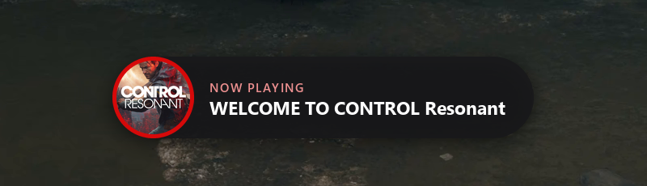
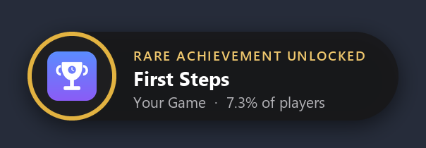

# Local Game Genesys

A playtime and achievement tracker for Windows PC games, wherever they came from: Steam, Epic, or a plain game folder on any drive.

It runs quietly in the background. When a game starts it records the session and can greet you with a pop-up. When you unlock an achievement it shows an Xbox-style pop-up at the top of the screen. The window shows your whole library with playtime, achievement progress, rarity and activity history.

## Features

- **Finds your games automatically** on the drives you choose: Steam libraries, Epic, and loose installs (`X:\Game` or `X:\Folder\Game`). Rescans every 30 minutes. Anything it misses can be added by hand.
- **Playtime.** A session starts when any program inside a game's folder runs and ends when it closes. Progress is saved every 30 seconds, so a crash loses at most 30 s. Very short sessions are ignored (adjustable). Time you played before installing is imported from Steam and from AMD Adrenalin's session log when available.
- **Achievements.** Names, descriptions, icons and global rarity are downloaded when missing (from the game's own files, the Steam client cache, the Steam Web API if you add a key, or SteamHunters and the Steam Community). Unlocks are read from every source the PC has and merged, earliest time first:
  - Steam (client cache and your public Steam profile)
  - Steam emulator save files (GSE / Goldberg, CODEX, RUNE, EMPRESS, ALI213, 3DM, OnlineFix, Tenoke)
  - achievement files inside the game folder, or any file you point it at
  - save-file readers for a few games that record no achievements anywhere else (Halo, Gears of War: E-Day)
  - marking an achievement earned by hand
- **Game launch pop-up**, fully customizable in Settings → Game launch pop-up: message (`{game}` and `{user}` placeholders), small header line, colour, picture (game cover or app logo), position (any corner or top/bottom middle), size, time on screen, sound (none, a sound you put in `sounds\`, or any `.wav` you choose) and how soon it may repeat for the same game.
- **Achievement pop-up** on every unlock, gold for rare ones (under 10% of players). It falls back to a Windows notification if the pop-up can't be drawn.
- **Session summary** notification when a game closes: time this session and in total.
- **Older history.** Games you've uninstalled still show under "Not installed", and reinstalling one merges its history back.

## Requirements

- Windows 10 or 11 (the window uses Microsoft Edge WebView2, already part of Windows 11)
- [Python 3.10 or newer](https://www.python.org/downloads/) with "Add python.exe to PATH" ticked

## Install

1. Download the latest release zip from the [Releases page](../../releases) and extract it somewhere permanent (for example `D:\Apps\LocalGameGenesys`).
2. Double-click **`install.bat`**.

The installer creates a private Python environment inside that folder and installs the dependencies from `requirements.txt`. It also adds a **Local Game Genesys** shortcut to the Desktop and the Start menu, plus a Startup shortcut that runs the background tracker at logon, and then opens the app.

On first start, open **Settings** and check **Drives to scan**. By default every fixed drive except the Windows drive is scanned. Then press **Save settings**.

## Tips

- **Pop-ups don't appear while gaming?** Windows 11 turns on *Do not disturb* while a game is running. Go to Settings → System → Notifications → *Set priority notifications* and add **Local Game Genesys**, or turn off the *When playing a game* automatic rule. The top-of-screen pop-ups can't draw over games in exclusive fullscreen; use borderless/windowed fullscreen.
- **Sounds:** none are included. Put your own `achievement.wav` in `sounds\` for achievement pop-ups (see `sounds\README.md`), or pick any `.wav` for the launch pop-up in Settings.
- **Wrong game matched?** Open the game and use *Change Steam match* or *Not on Steam*.
- **Unlocks not detected?** The game's page says so and offers *Locate unlock file…*. For GSE/Goldberg copies that shipped without an achievement list (they then discard every unlock), the page offers a fix that writes the downloaded list into the game's `steam_settings` folder.
- **Steam Web API key** (optional, free at <https://steamcommunity.com/dev/apikey>): adds locked icons and hidden-achievement flags.

## Files

| Path | What it is |
| --- | --- |
| `app.pyw` + `ui\` | the window (pywebview / WebView2) |
| `tracker.pyw` | background service: sessions, unlock detection, pop-ups |
| `core.py` | engine: game discovery, database, achievement sources |
| `overlay.py` | the top-of-screen pop-up (`venv\Scripts\python.exe overlay.py` shows a test) |
| `config.json` | your settings (created on first run, also editable in the app) |
| `data\tracker.db` | SQLite database: games, sessions, achievements, unlocks |
| `data\cache\` | downloaded covers and achievement icons |
| `data\gametracker.log` | log file |

Debug the window with `venv\Scripts\python.exe app.pyw --debug` (opens the WebView dev tools).

## Uninstall

Right-click **`uninstall.ps1`** → *Run with PowerShell*. It stops the app and removes the shortcuts. Then delete the folder. Your data is in its `data\` folder, so delete that too unless you want to keep your history.

## Privacy

Everything stays on your PC. The app only connects to the internet to download game information (Steam store, Steam Community, SteamHunters, and the Steam Web API if you add a key). It reads your *public* Steam profile's achievement page for Steam games.

## Disclaimer

Not affiliated with Valve, Microsoft, Epic Games or AMD. Game names, covers and achievement data belong to their respective owners and are downloaded on your PC at run time; none are included in this repository.

## License

[MIT](LICENSE)
