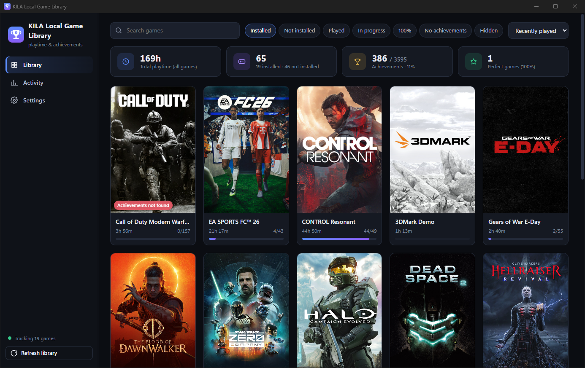
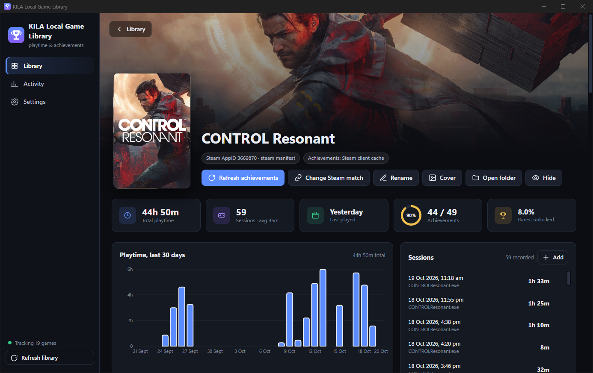
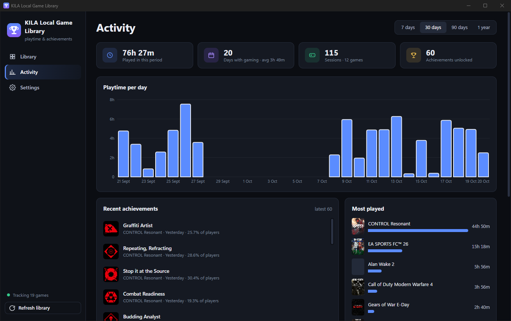
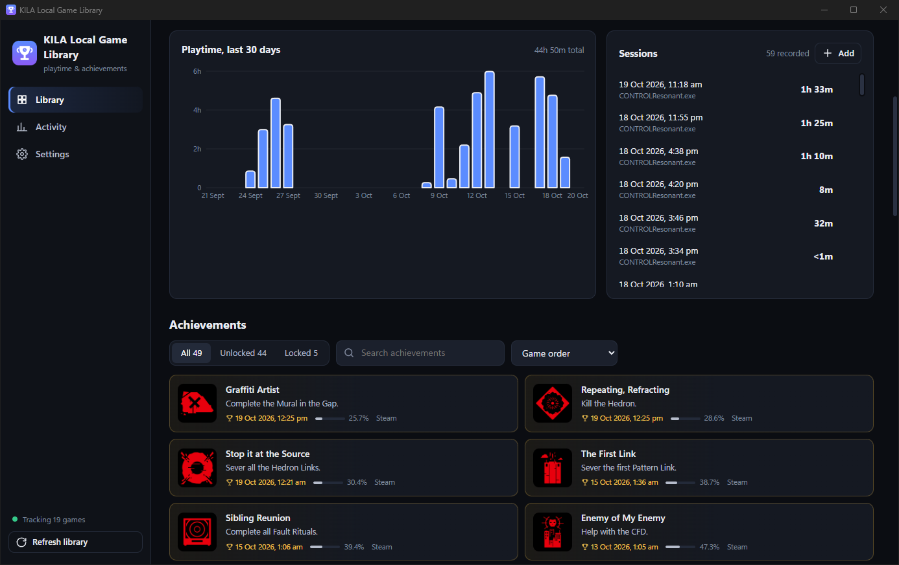
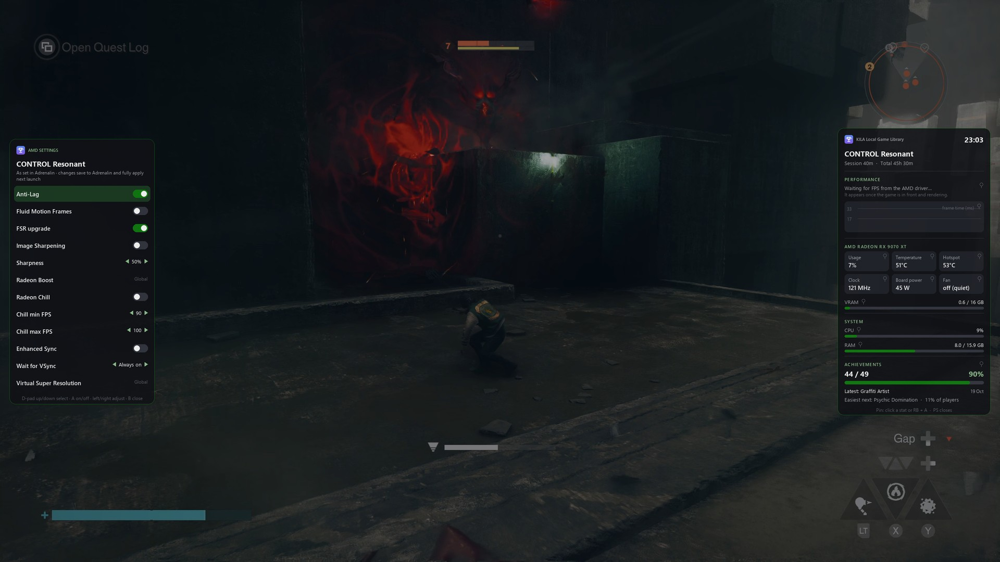
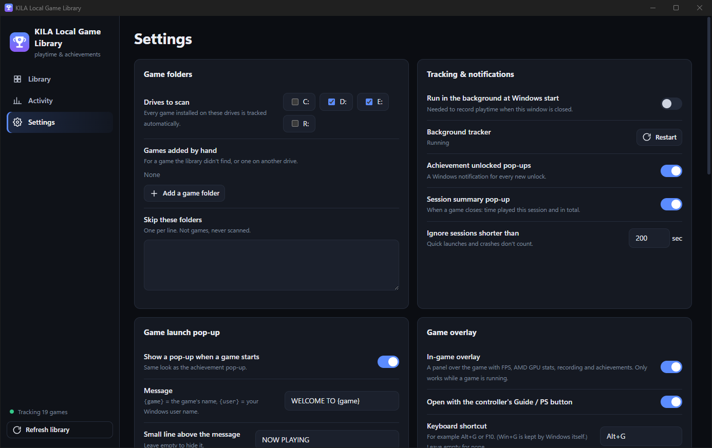

# KILA Local Game Library

> **For PCs with an AMD Radeon graphics card only.** The in-game overlay, FPS counter, GPU stats and per-game AMD settings come straight from the AMD Adrenalin driver. The installer stops on NVIDIA or Intel graphics.

A free playtime and achievement library for **every** Windows PC game, wherever it came from (Steam, Epic, or a plain folder on any drive), plus an **Xbox-style in-game overlay** for AMD Radeon users.

It runs quietly in the background. When a game starts it records the session and greets you with a pop-up. When you unlock an achievement you get an Xbox-style pop-up. Press the **PS / Xbox button** (or **Alt+G**) in a game and an overlay slides in with FPS, AMD GPU stats, achievements and your per-game **Adrenalin** settings.

## Features

### Library
- **Finds your games automatically** on the drives you choose: Steam libraries, Epic, and loose installs (`X:\Game` or `X:\Folder\Game`). Rescans every 30 minutes, never while you're playing. Anything it misses can be added by hand.
- Covers and artwork downloaded automatically; rename a game, change its cover, hide it, or open its folder.
- Filters: Installed, Not installed, Played, In progress, 100%, No achievements, Hidden. Sort by recently played, most played, achievement %, name or recently added.
- **Older history:** games you've uninstalled stay under "Not installed", and reinstalling one merges its history back.

### Playtime
- A session starts when any program inside a game's folder runs and ends when it closes. Progress is saved every 30 s, so a crash loses at most 30 s. Sleep/resume splits the session correctly. Very short sessions are ignored (adjustable).
- Per-game page: total time, sessions, average, last played, a 30-day chart and the full session list (add or fix sessions by hand).
- **Activity page:** playtime per day for 7 / 30 / 90 days or a year, most played games, recent achievements.
- **Imports your past playtime** from Steam and from **AMD Adrenalin's own game-session log**, so history from before you installed the app shows up too.

### Achievements
- Names, descriptions, icons and **global rarity** downloaded automatically (game files, Steam client cache, SteamHunters, Steam Community, or the Steam Web API if you add a free key).
- Unlocks are read from every source on the PC and merged, earliest time first:
  - Steam (client cache and your public Steam profile)
  - Steam emulator save files (GSE / Goldberg, CODEX, RUNE, EMPRESS, ALI213, 3DM, OnlineFix, Tenoke)
  - achievement files inside the game folder, or any file you point it at
  - save-file readers for games that record achievements nowhere else (Halo, Gears of War: E-Day)
  - marking an achievement earned by hand
- Filter all / unlocked / locked, search, sort by game order, recently unlocked, rarest, most common or name.

### Pop-ups
- **Achievement pop-up** on every unlock, gold for rare ones (under 10% of players), with your own sound. A burst of unlocks shows 3 pop-ups and then one "+N more" summary.
- **Game launch pop-up**, fully customizable: message (`{game}` / `{user}`), header line, colour, game cover or app logo, position (any corner or top/bottom middle), size, time on screen, sound, and how soon it may repeat. It waits until the game's window has settled, so it doesn't blink while the game changes resolution.
- **Session summary** notification when a game closes.

### In-game overlay (AMD Radeon)
Press the **controller's PS / Xbox (Guide) button** or **Alt+G** while a game runs:
- **Performance:** FPS and a frame-time graph straight from the AMD driver (the same numbers Adrenalin shows).
- **AMD Radeon stats:** usage, clock, temperature, hotspot, board power, fan, VRAM. **System:** CPU and RAM.
- **Achievements** for the game you're playing: progress, latest unlock, and the easiest one still locked.
- **Recording status** for OBS: on/off, length, file size.
- **AMD settings panel (left), saved per game in Adrenalin:** Anti-Lag, Fluid Motion Frames (AFMF), FSR upgrade, Image Sharpening + sharpness, Radeon Boost, Radeon Chill + min/max FPS, Enhanced Sync, Wait for VSync, Virtual Super Resolution. Change them without leaving the game.
- **Pinned stats:** pin FPS, frame time, GPU usage/temp, VRAM, CPU, RAM… to a small strip that stays on screen while you play.
- Fully driven by controller: D-pad to move, A to toggle, left/right to adjust, B to close, RB + A to pin. The game gets a neutral controller while the panel is open.
- Position, size, opacity, colour, background haze and auto-close are set in Settings → Game overlay.
- Costs nothing while no game runs. During a game it reads the controller 30 times a second (microseconds) and the driver twice a second.

## Requirements

| What | Notes |
| --- | --- |
| **AMD Radeon graphics card** | required. RX 6000 / 7000 / 9000 series recommended (Fluid Motion Frames and FSR upgrade need a recent card) |
| **AMD Software: Adrenalin Edition** | required, keep it up to date: [amd.com/support](https://www.amd.com/en/support/download/drivers.html). The overlay talks to the driver through AMD's own ADLX library |
| **Windows 10 or 11, 64-bit** | |
| **Microsoft Edge WebView2 Runtime** | built into Windows 11; on Windows 10 get it from [Microsoft](https://developer.microsoft.com/microsoft-edge/webview2/) |
| **Python 3.10 or newer (64-bit)** | [python.org/downloads](https://www.python.org/downloads/), tick **"Add python.exe to PATH"** |
| **OBS Studio** (optional) | only for the overlay's recording status |
| **A controller** (optional) | Xbox, or PS5 DualSense through [ABridge DUALXBOX Configuration](https://github.com/R1tom/ABridge-DUALXBOX) or Steam, for opening the overlay with the PS / Xbox button |

## Install

1. Download the latest zip from the [Releases page](https://github.com/R1tom/kila-local-game-library/releases/latest) and extract it somewhere permanent (for example `D:\Apps\KILA`).
2. Double-click **`install.bat`**. It checks for an AMD Radeon card, the Adrenalin driver and WebView2, creates a private Python environment, installs the dependencies, adds Desktop / Start menu shortcuts plus two Startup shortcuts (background tracker and game overlay), and opens the app.
3. Open **Settings**, check **Drives to scan** (default: every fixed drive except the Windows drive) and press **Save settings**.
4. Do the one-time setup below.

## Set up Windows, Steam and AMD (important)

Several programs fight over the PS / Xbox button and over the top of the screen. Check these once:

**Xbox Game Bar (Win+G)**
- Settings → Gaming → Game Bar → turn **off** *"Open Game Bar using this button on a controller"*. Otherwise the Xbox / PS button opens Game Bar on top of the KILA overlay.
- Win+G always belongs to Windows, which is why the KILA shortcut is **Alt+G**. You can change it in Settings → Game overlay (e.g. F10).
- If you don't use Game Bar at all you can uninstall it: PowerShell `Get-AppxPackage Microsoft.XboxGamingOverlay | Remove-AppxPackage`.

**Steam**
- Steam → Settings → Controller → turn **off** *"Guide Button Focuses Steam"*, so the PS / Xbox button opens KILA, not Steam's Big Picture overlay.
- If a Steam game still grabs the button: right-click the game → Properties → Controller → **Disable Steam Input**.
- The Steam in-game overlay (Shift+Tab) can stay on; it doesn't conflict. Steam's own FPS counter isn't needed, since KILA shows the driver's FPS.

**AMD Adrenalin**
- Adrenalin's own overlay is **Alt+R** and its metrics overlay **Ctrl+Shift+O**; don't give KILA the same hotkey. Turn Adrenalin's metrics overlay off if you don't want two FPS counters.
- Per-game settings you change in the KILA overlay are saved into Adrenalin's own profile for that game (a backup `User.blb.bak-<date>` is made first), so Adrenalin shows the same values. They fully apply the next time you launch the game.

**Games and notifications**
- Use **borderless / windowed fullscreen**. Windows can't draw any overlay or pop-up over a game in *exclusive* fullscreen.
- Windows 11 turns on **Do not disturb** while gaming, which hides the Windows notifications (session summary, fallback toasts). Settings → System → Notifications → *Set priority notifications* → add **KILA Local Game Library**, or turn off the *When playing a game* rule.
- Recording status: set `overlay_recording_folder` in `config.json` to the folder OBS records to (default: your Videos folder).

## Tips

- **Sounds:** none are included. Put your own `achievement.wav` (and `achievement-rare.wav`) in `sounds\`, or pick any `.wav` for the launch pop-up in Settings.
- **Wrong game matched?** Open the game and use *Change Steam match* or *Not on Steam*.
- **Unlocks not detected?** The game's page says so and offers *Locate unlock file…*. For GSE/Goldberg copies that shipped without an achievement list (they then discard every unlock), the page offers a fix that writes the downloaded list into the game's `steam_settings` folder.
- **Steam Web API key** (optional, free at <https://steamcommunity.com/dev/apikey>): adds locked icons and hidden-achievement flags.
- **Overlay doesn't open?** Check `data\game_overlay.log`. "hotkey is taken" means another app owns the shortcut; pick a different one.

## Files

| Path | What it is |
| --- | --- |
| `app.pyw` + `ui\` | the window (pywebview / WebView2) |
| `tracker.pyw` | background service: sessions, unlock detection, pop-ups |
| `game_overlay.pyw` | the in-game overlay (started at logon) |
| `adlx.py` / `adl_profiles.py` / `adrenalin_blb.py` | AMD driver stats, and reading / writing Adrenalin's per-game settings |
| `core.py` | engine: game discovery, database, achievement sources |
| `overlay.py` | the pop-ups (`venv\Scripts\python.exe overlay.py` shows a test) |
| `config.json` | your settings (created on first run, also editable in the app) |
| `data\tracker.db` | SQLite database: games, sessions, achievements, unlocks |
| `data\cache\` | downloaded covers and achievement icons |
| `data\*.log` | log files |

Debug the window with `venv\Scripts\python.exe app.pyw --debug` (opens the WebView dev tools).

## Uninstall

Right-click **`uninstall.ps1`** → *Run with PowerShell*. It stops the app and removes the shortcuts. Then delete the folder. Your data is in its `data\` folder, so delete that too unless you want to keep your history.

## Privacy

Everything stays on your PC. The app only connects to the internet to download game information (Steam store, Steam Community, SteamHunters, and the Steam Web API if you add a key). It reads your *public* Steam profile's achievement page for Steam games.

## Disclaimer

Not affiliated with AMD, Valve, Microsoft or Epic Games. AMD, Radeon and Adrenalin are trademarks of Advanced Micro Devices. Game names, covers and achievement data belong to their respective owners and are downloaded on your PC at run time; none are included in this repository. The overlay edits Adrenalin's per-game profile file only through same-size in-place changes, with a backup first; use it at your own risk.

## Changelog

**2.0.0**
- Renamed from Local Game Genesys to **KILA Local Game Library**, now made for AMD Radeon PCs.
- New **in-game overlay** (PS / Xbox button or Alt+G): driver FPS + frame-time graph, Radeon stats, CPU/RAM, achievements, OBS recording status, pinned stats strip, and per-game **Adrenalin settings** (Anti-Lag, AFMF, FSR upgrade, sharpening, Boost, Chill, Enhanced Sync, VSync, VSR).
- Works with **ABridge DUALXBOX Configuration**: the DualSense's PS button opens the overlay and the game gets a neutral pad while it's open.
- Installer checks for an AMD Radeon card, the Adrenalin driver and WebView2, and adds the overlay to Startup.
- README: full requirements and Windows / Steam / AMD setup guide.

**1.1.0**
- Launch pop-up waits until the game's window has settled, and isn't shown again after sleep/resume or a tracker restart mid-game.
- A burst of more than 4 unlocks shows the first 3 pop-ups, then one "+N more achievements" summary.
- Rare unlocks (under 10% of players) play `sounds\achievement-rare.wav` if you add one.
- No drive scans or downloads while a game is running; no "Played …" toast over a game resumed from sleep.
- Toasts no longer flash a PowerShell window over the game.

**1.0.0** — first release.

## License

[MIT](LICENSE)
